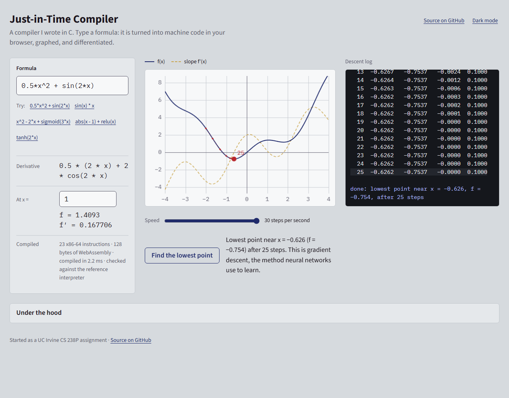
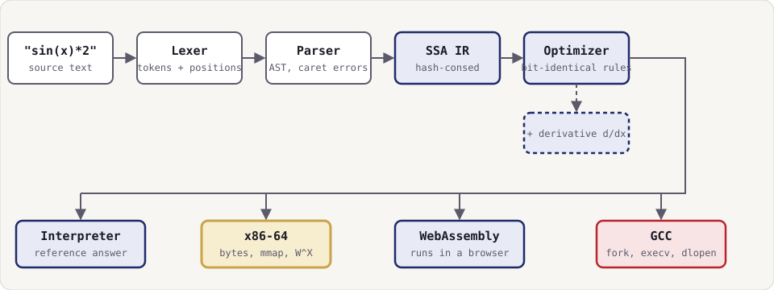
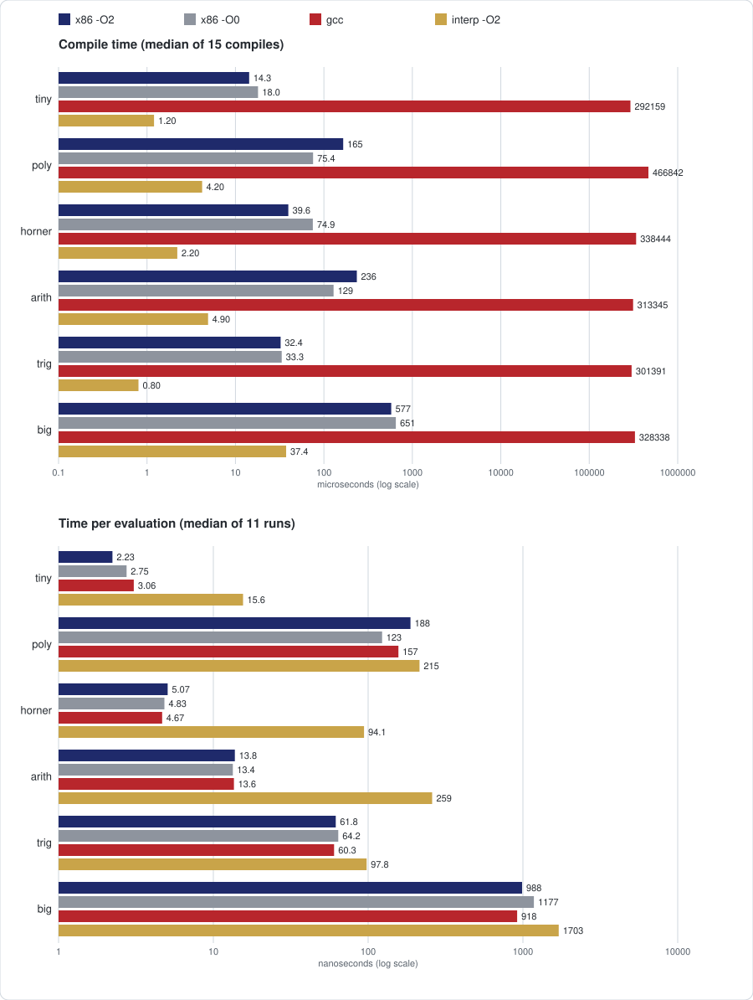

# JIT Compiler

[](https://github.com/JohnFok119/JIT-Compiler/actions/workflows/ci.yml)

A just-in-time compiler for math expressions, written in C11: it turns a formula such as `sin(x)^2 + cos(x)^2` into x86-64 machine code at run time, writes the bytes into memory itself and calls them.

Try it in your browser: <https://johnfok119.github.io/JIT-Compiler/> (also on my portfolio: <https://wood-o7.vercel.app/projects/jit-v2/demo/>)




## What it does

- Evaluates expressions with variables (`x`, `y`, up to 8 per expression), the constants `pi` and `e`, the operators `+ - * / ^`, and the functions `sin cos tan exp log sqrt abs tanh sigmoid relu min max pow`.
- Compiles through a hash-consed SSA intermediate representation (IR) and an optimizer, then runs the result on four backends: a reference interpreter, a hand-written x86-64 code generator, the GCC path, and WebAssembly.
- Prints every stage on request: tokens, AST, IR before and after optimization, x86-64 assembly and raw bytes, the generated C, and the WebAssembly module.
- Differentiates symbolically: `--diff x` computes the derivative as an expression, optimizes it and can evaluate it.
- Reports parse errors with a caret under the bad spot, follows IEEE 754 double semantics (`1/0` is `inf`), and has a `--legacy` mode that reproduces the original program.

## How it works



**Lexer and parser** (`src/front/`). The lexer produces tokens with line and column. A recursive-descent parser builds the AST; `^` is right-associative and binds tighter than unary minus, so `-x^2` is `-(x^2)`. Errors carry the position of the offending token.

**SSA IR with hash-consing** (`src/ir/`). The AST is lowered to a list of nodes in topological order, each assigned once. Nodes are created through a table keyed on operation, operands and constant bits, so an expression computed twice is stored once: common-subexpression elimination falls out of construction. `--emit ir` prints it.

**Optimizer** (`src/opt/`). Constant folding, a small set of algebraic simplifications, strength reduction (division by a power of two becomes a multiplication, `x^1` becomes `x`) and dead-node removal. The rule is that every transformation keeps the result bit-identical to the interpreter, so `x + 0`, `x * 0` and reassociation are left alone because of `-0`, NaN and infinity. `-O0` and `-O2` select the level.

**Backends** (`src/backend/`).
- *Interpreter* (`src/ir/interp.c`): walks the IR. It defines the meaning of every operation and is the reference the other backends are checked against.
- *x86-64* (`src/backend/x86_64/`): a hand-written instruction encoder, linear-scan register allocation over `xmm0` to `xmm15`, and constants in a RIP-relative pool. The bytes are written to an `mmap`ed page that is writable, then switched with `mprotect` to executable, never both at once (W^X).
- *GCC* (`src/backend/gcc/`): the original approach, fixed and kept. It writes C source to a private temporary directory, runs `gcc -shared` through `fork`, `execvp` and `waitpid`, then loads the result with `dlopen` and `dlsym`.
- *WebAssembly* (`src/backend/wasm/`, `src/web/`): emits a WebAssembly module for the expression. The whole engine also builds with Emscripten, which is what the browser demo runs.

**Derivatives** (`src/ir/diff.c`). Symbolic differentiation on the IR with per-operation rules and the chain rule. The result goes back through the same builder and optimizer. Points where a function has a kink print as `step(...)`.

## Correctness

- **Bit-identical results.** The optimizer, the x86-64 backend and the GCC backend must produce the same bits as the interpreter on the unoptimized IR, with any NaN counting as equal to any NaN. The WebAssembly backend is checked by its unit tests and by a Node smoke test in CI.
- **Differential fuzzing with shrinking.** `tests/fuzz/difftest.c` generates random expressions and their derivatives, runs them on the interpreter (-O0 and -O2), the x86-64 backend (-O0 and -O2) and, for every Kth expression, the GCC backend, and compares the bits. A failing expression is shrunk before it is reported.
- **Per-rule property tests.** `tests/fuzz/rulefuzz.c` builds the smallest IR that triggers each optimizer rewrite and checks that the result before and after the rewrite, on the interpreter and on x86-64, is bit-identical over many random and special values.
- **Objdump-checked encoder.** `tests/check-encoding.sh` disassembles the bytes the encoder emits with `objdump` and compares each instruction with the encoder's own listing.
- **Sanitizers.** `make asan` builds with AddressSanitizer and UBSan and runs the unit tests, golden CLI cases and a fuzz run.
- **CI.** `.github/workflows/ci.yml` runs `make check` and `make asan`, a long fuzz run, and the WebAssembly build with a Node smoke test.

## Performance



The x86-64 backend compiles in 14 to 651 microseconds, while the GCC backend takes 0.26 to 0.47 seconds because it starts a `gcc` process. On plain arithmetic the interpreter is about 14 to 21 times slower per evaluation than compiled code, and on expressions dominated by libm the gap shrinks to 1.1 to 1.7 times. These numbers come from a shared laptop under WSL2 and individual rows vary by tens of percent; [docs/benchmarks.md](docs/benchmarks.md) has the method, the machine and the noise measurements.

## Build and run

Linux x86-64, `gcc`, `make` and `binutils` (for the encoder check).

```
make          # builds build/jit
make check    # unit tests, golden CLI cases, encoder check, fuzzers
make asan     # AddressSanitizer + UBSan build and tests
```

Evaluate, with variables:

```
$ jit '2 + 3 * 4'
14
$ jit 'sin(x)^2 + cos(x)^2' x=0.7
1
```

Print the x86-64 code the compiler wrote (`--emit asm`):

```
$ jit --emit asm 'x*x + 3*x'
0000  55                             push rbp
0001  48 89 e5                       mov rbp,rsp
0004  53                             push rbx
0005  48 81 ec 08 00 00 00           sub rsp,0x8
000c  48 89 fb                       mov rbx,rdi
000f  f2 0f 10 83 00 00 00 00        movsd xmm0,QWORD PTR [rbx+0x0]  ; %0
0017  66 0f 28 c8                    movapd xmm1,xmm0  ; %1
001b  f2 0f 59 c8                    mulsd xmm1,xmm0  ; %1
001f  f2 0f 10 15 19 00 00 00        movsd xmm2,QWORD PTR [rip+c0]  ; %2
0027  f2 0f 59 d0                    mulsd xmm2,xmm0  ; %3
002b  f2 0f 58 ca                    addsd xmm1,xmm2  ; %4
002f  66 0f 28 c1                    movapd xmm0,xmm1  ; %4
0033  48 81 c4 08 00 00 00           add rsp,0x8
003a  5b                             pop rbx
003b  5d                             pop rbp
003c  c3                             ret
; constant pool
0040  c0   00 00 00 00 00 00 08 40 00 00 00 00 00 00 00 00  ; 3
```

Differentiate (`--diff`):

```
$ jit --diff x 'x^3 + sin(x)*x'
3 * x^2 + (cos(x) * x + sin(x))
```

Show the optimizer at work (`--emit ir` prints the IR before and after `-O2`):

```
$ jit --emit ir 'x*2 + x*2'
%0 = var x
%1 = const 2
%2 = mul %0, %1
%3 = add %2, %2
ret %3
; after -O2
%0 = var x
%1 = add %0, %0
%2 = add %1, %1
ret %2
```

Compare the backends (`--bench N` times compile and N evaluations on each; the numbers vary by machine):

```
$ jit --bench 1000000 '((3*x - 2)*x + 5)*x - 1'
backend      compile_us    ns_per_eval
interp-O2           0.8          36.02
x86-O0             24.6           2.60
x86-O2             25.8           2.59
gcc            404791.1           3.60
```

The original assignment's behaviour (`--legacy`: the result goes through `sigmoid`, and division by zero gives 0):

```
$ jit --legacy '1-1'
0.500000
```

Errors point at the problem:

```
$ jit '(1 + 2'
error: expected ')'
  (1 + 2
        ^
```

With no expression on a terminal, `jit` starts a prompt (`:q` quits, `:emit STAGE` toggles a stage dump):

```
jit> sin(1)
0.8414709848078965
jit> :q
```

`jit --help` lists every option with an example.

To try the browser build locally: `make wasm` (needs Emscripten, for example the `emscripten/emsdk:3.1.74` Docker image), `make web`, then `node scripts/serve.mjs web/site 8080`. Add `?expr=...&drop=1&race=1` to the URL to fill the formula, drop the gradient-descent ball and run the race on load (see the top of `web/app.js`).

## Project layout

```
include/jit.h        public API
src/front/           lexer and parser
src/ir/              IR builder, printer, interpreter, derivatives
src/opt/             optimizer passes
src/backend/         x86_64, gcc and wasm backends
src/cli/             command line, REPL, benchmark driver
src/runtime/         runtime helpers shared by the backends
src/web/             Emscripten entry points for the browser build
tests/               unit tests, golden CLI cases, fuzzers, encoder and REPL checks
bench/               benchmark suite and runner
docs/                benchmark write-up, chart, demo media, terminal clip script
web/                 browser demo page
scripts/             chart generator and static server
.github/workflows/   CI
```

## Origins

Started as a UC Irvine CS 238P (Operating Systems) assignment: the course skeleton and Makefile are © Tony Givargis, 2023–2025. The original version is at [github.com/giuseppi/JIT-Compiler](https://github.com/giuseppi/JIT-Compiler). The `--legacy` flag reproduces its behaviour.

## License

MIT for the code written for this project; see [LICENSE](LICENSE). Files from the CS 238P course skeleton keep their original terms, and the web fonts are under the SIL Open Font License.
